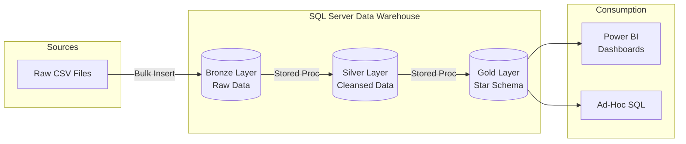
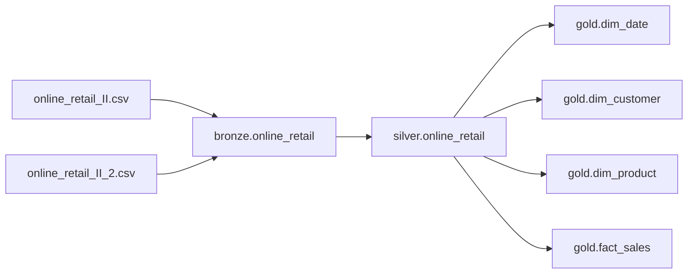
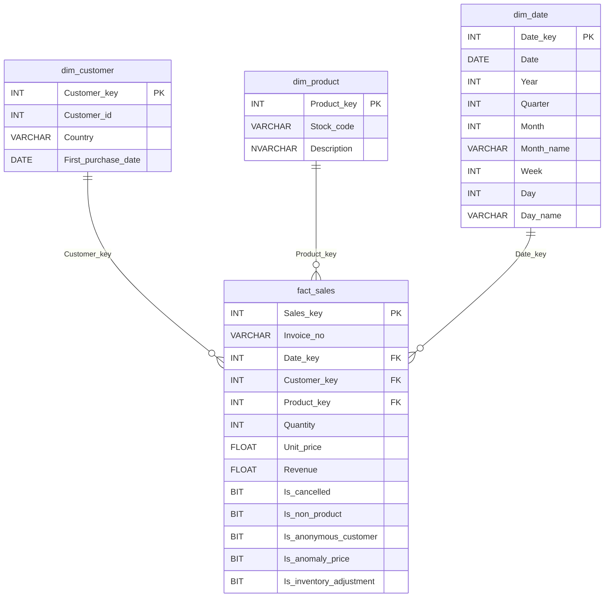

# System Architecture & Data Flow

This document outlines the architectural decisions and data flow for the Retail Analytics Data Warehouse.

## 1. High Level Architecture

The pipeline follows a Medallion Architecture pattern built entirely within SQL Server using Stored Procedures for ETL orchestration.

## 2. Data Flow (Lineage)

## 3. Data Integration & Transformations (Silver Layer)
Instead of filtering out messy data, the Silver layer uses a **"Tag, Don't Delete"** strategy. 

* **Type Casting:** Strings safely cast to `INT`, `FLOAT`, and `DATETIME`.
* **String Standardization:** Leading/trailing spaces and hidden carriage returns (`CHAR(13)`) removed.
* **Date Parsing:** Explicitly parsing British date formats (`DD-MM-YYYY`) using style `105`.
* **Business Logic Flags:**
  * `Is_cancelled`: Flags invoices starting with 'C'.
  * `Is_non_product`: Flags operational stock codes (e.g., 'POST', 'M').
  * `Is_anonymous_customer`: Flags transactions missing a Customer ID (Mapped to `-1`).
  * `Is_anomaly_price`: Flags rows where Price <= 0.
  * `Is_inventory_adjustment`: Flags rows where Quantity < 0 without a cancellation invoice.

## 4. Sales Data Mart (Gold Layer Star Schema)

The Gold layer implements a Kimball Star Schema. A key design decision was generating Customer "Profiles" by combining `Customer_id` and `Country` to accurately track geographic sales even for anonymous users.

